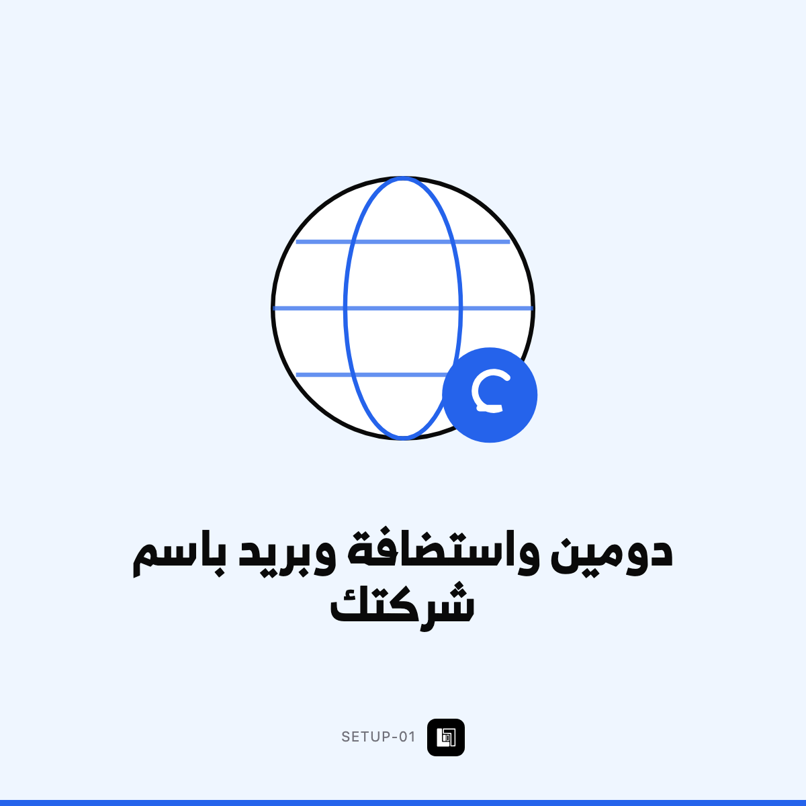

# دومين واستضافة وبريد باسم شركتك

`SETUP-01` · ابدأ من هنا · 1 خيار

> **هذا الملف = حقول Wayl جاهزة للنسخ.** لا تعدّله — عدّل `income/wayl/items.json`
> وشغّل `node income/wayl/render.mjs`.

## 1️⃣ اسم المنتج

```
دومين واستضافة وبريد باسم شركتك
```

## 2️⃣ الوصف — انسخه كاملاً

```
شغلة صغيرة تغيّر شكلك عند الزبون تماماً: بدل `ahmed1990@gmail.com` يصير `info@اسم-شركتك.com`.

أسوي لك:

· اختيار وشراء الدومين المناسب (كلفة الدومين على حسابك ~$12/سنة)
· إعداد الاستضافة وربطها
· بريد إلكتروني باسم شركتك — حتى 5 عناوين
· إعداد الحماية الأساسية وشهادة SSL
· تسليم كل كلمات المرور لك — **الملكية باسمك أنت من اليوم الأول**

💡 هذي أرخص شغلة بالمتجر وأكثر شي يبيّن الفرق. تنفع كخطوة أولى قبل الموقع.
```

## 3️⃣ السعر الأساسي

**$55** · 72,600 د.ع  
*(سعر أرخص خيار — الباقي يُضاف كفروق أدناه)*

## 4️⃣ الخيارات

بلا خيارات — منتج بسعر واحد.

## 5️⃣ الصورة



**`card.png`** بنفس المجلد · 1200×1200 · **بلا سعر وبلا درجات على الصورة** —
الأسعار بحقل الوصف حصراً.

## 6️⃣ إعدادات أخرى

| الحقل | القيمة |
|---|---|
| المخزون | **غير محدود** — خدمة لا بضاعة |
| المجموعة | ابدأ من هنا |
| الظهور | ظاهر |

---

⬅️ [رجوع لفئة ابدأ من هنا](../README.md) · [كل الفئات](../../README.md)
