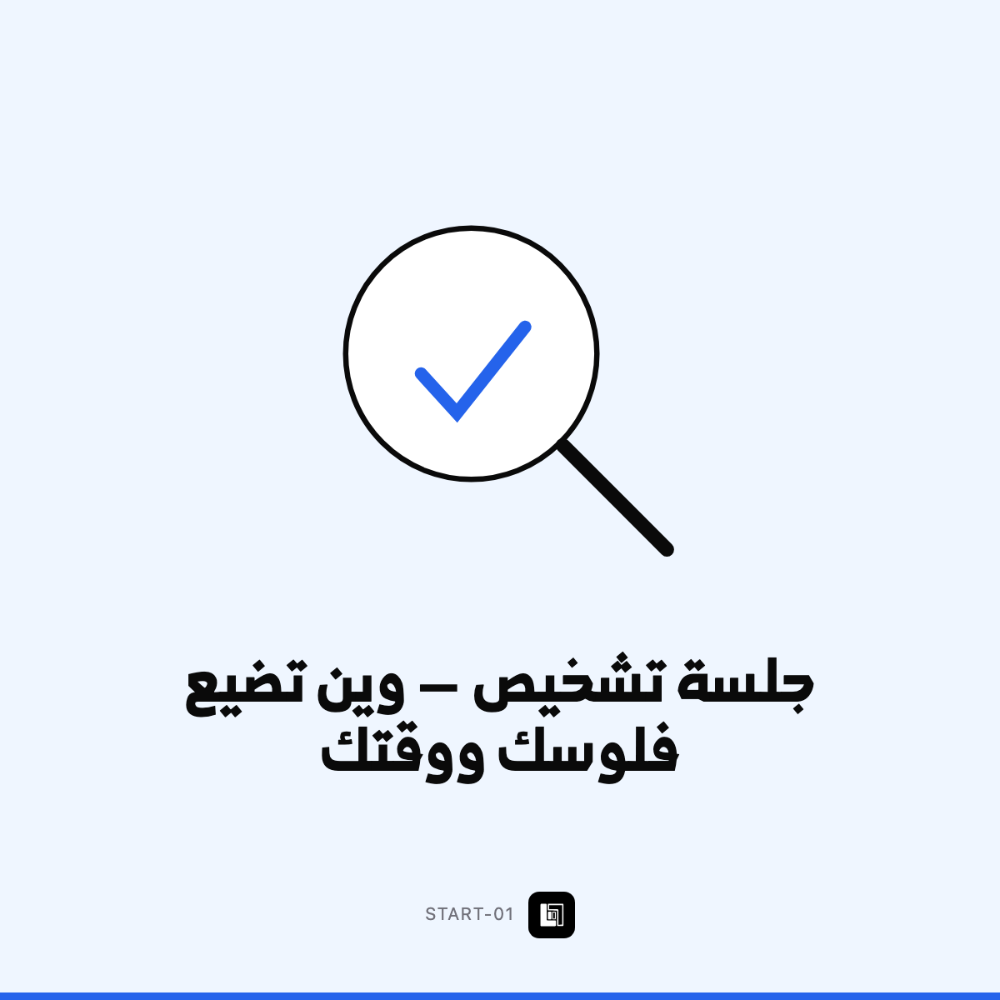

# جلسة تشخيص — وين تضيع فلوسك ووقتك

`START-01` · ابدأ من هنا · 1 خيار

> **هذا الملف = حقول Wayl جاهزة للنسخ.** لا تعدّله — عدّل `income/wayl/items.json`
> وشغّل `node income/wayl/render.mjs`.

## 1️⃣ اسم المنتج

```
جلسة تشخيص — وين تضيع فلوسك ووقتك
```

## 2️⃣ الوصف — انسخه كاملاً

```
قبل ما تصرف على أي مشروع، اعرف إذا تحتاجه أصلاً.

نقعد ساعة بالمكالمة — تحچيلي شلون تشتغل: كيف تجيك الطلبات، وين تنحفظ، منو يتابعها، شنو الشغلة اللي تكررها كل يوم وتاخذ منك وقت. بعدها أرسل لك تقرير مكتوب بصفحتين:

· شنو ينفع يُحسَّن، مرتّباً من الأهم
· كم وقت أو فلوس يوفّر كل بند تقريباً
· كم يكلّف وكم ياخذ وقت
· وشنو تقدر تسويه بنفسك بلا ما تدفع لأحد

💡 مبلغ الجلسة يُخصم كاملاً من أي مشروع تطلبه خلال 30 يوم. يعني عملياً مجانية إذا كملنا سوا.
```

## 3️⃣ السعر الأساسي

**$40** · 52,800 د.ع  
*(سعر أرخص خيار — الباقي يُضاف كفروق أدناه)*

## 4️⃣ الخيارات

بلا خيارات — منتج بسعر واحد.

## 5️⃣ الصورة



**`card.png`** بنفس المجلد · 1200×1200 · **بلا سعر وبلا درجات على الصورة** —
الأسعار بحقل الوصف حصراً.

## 6️⃣ إعدادات أخرى

| الحقل | القيمة |
|---|---|
| المخزون | **غير محدود** — خدمة لا بضاعة |
| المجموعة | ابدأ من هنا |
| الظهور | ظاهر |

---

⬅️ [رجوع لفئة ابدأ من هنا](../README.md) · [كل الفئات](../../README.md)
