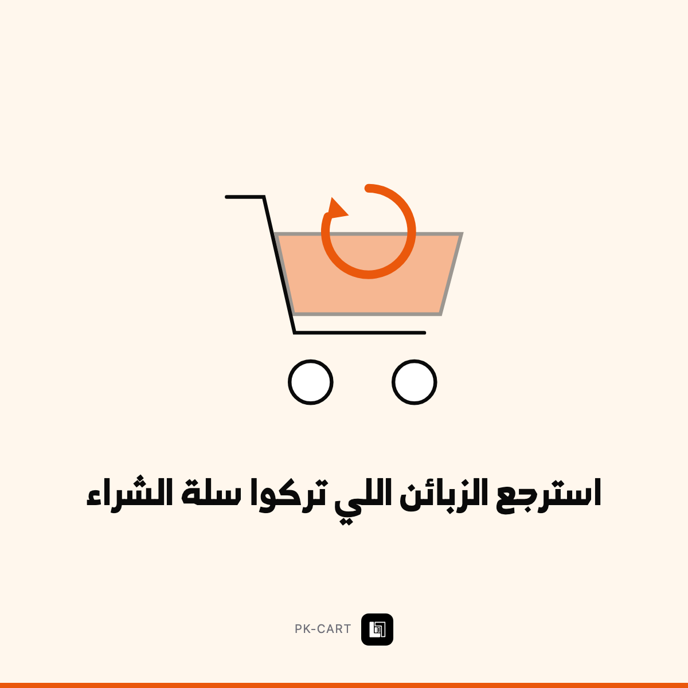

# استرجع الزبائن اللي تركوا سلة الشراء

`PK-CART` · حلول جاهزة — زبائن ومبيعات · 2 خيارات

> **هذا الملف = حقول Wayl جاهزة للنسخ.** لا تعدّله — عدّل `income/wayl/items.json`
> وشغّل `node income/wayl/render.mjs`.

## 1️⃣ اسم المنتج

```
استرجع الزبائن اللي تركوا سلة الشراء
```

## 2️⃣ الوصف — انسخه كاملاً

```
**سبعة من كل عشرة** يحطون منتجات بالسلة وما يكملون الشراء. هؤلاء أقرب زبائن عندك — اختاروا المنتج فعلاً.

**شنو يسوي:**
لما يترك زبون سلته:

· **بعد ساعة:** رسالة واتساب ودّية تذكّره بالمنتج مع صورته ورابط مباشر
· **بعد يوم:** رسالة ثانية، وإذا حددت، مع كوبون خصم بسيط
· **يتوقف فوراً** لما يشتري أو يطلب الإيقاف

وتشوف بالجدول: كم سلة استُرجعت وكم فلوس رجعت لك.

**اختر درجتك:**

**تذكير بسيط** — رسالة واحدة بعد ساعة، وتقرير بالنتائج.

**سلسلة كاملة** — 3 رسائل بتوقيتات مدروسة + كوبونات تلقائية + قياس العائد.

💡 **هذي الأتمتة الوحيدة اللي تحسب أرباحها بنفسك:** إذا رجّعت سلتين بالشهر، دفعت ثمنها.
```

## 3️⃣ السعر الأساسي

**$160** · 211,000 د.ع  
*(سعر أرخص خيار — الباقي يُضاف كفروق أدناه)*

## 4️⃣ الخيارات

| الخيار | السعر | يشمل | التسليم |
|---|---|---|---|
| تذكير بسيط | $160 · 211,000 د.ع | رسالة بعد ساعة · رابط مباشر للسلة · تقرير الاسترجاع | 4 أيام |
| سلسلة كاملة | $340 · 449,000 د.ع | 3 رسائل بتوقيتات مدروسة · كوبونات تلقائية · قياس العائد بالدينار | 8 أيام |

### فروق أسعار الخيارات — أدخلها بـWayl كما هي

السعر الأساسي للمنتج: **$160** (تذكير بسيط)

| الخيار | الفرق المضاف | السعر النهائي |
|---|---|---|
| سلسلة كاملة | **+$180** | $340 · 449,000 د.ع |

## 5️⃣ الصورة



**`card.png`** بنفس المجلد · 1200×1200 · **بلا سعر وبلا درجات على الصورة** —
الأسعار بحقل الوصف حصراً.

## 6️⃣ إعدادات أخرى

| الحقل | القيمة |
|---|---|
| المخزون | **غير محدود** — خدمة لا بضاعة |
| المجموعة | حلول جاهزة — زبائن ومبيعات |
| الظهور | ظاهر |
| ⚠️ بناء لمرة واحدة | 12 ساعة — لا تبعه قبل ما تبنيه |

---

⬅️ [رجوع لفئة حلول جاهزة — زبائن ومبيعات](../README.md) · [كل الفئات](../../README.md)
