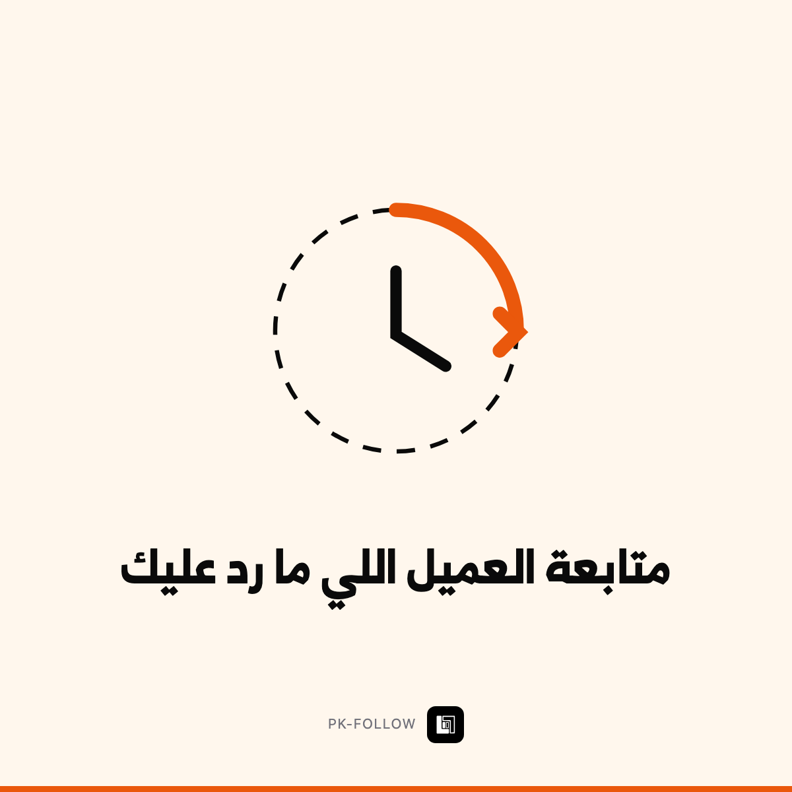

# متابعة العميل اللي ما رد عليك

`PK-FOLLOW` · حلول جاهزة — زبائن ومبيعات · 2 خيارات

> **هذا الملف = حقول Wayl جاهزة للنسخ.** لا تعدّله — عدّل `income/wayl/items.json`
> وشغّل `node income/wayl/render.mjs`.

## 1️⃣ اسم المنتج

```
متابعة العميل اللي ما رد عليك
```

## 2️⃣ الوصف — انسخه كاملاً

```
أغلب الصفقات تضيع مو لأن العميل رفض — بل لأن **ما أحد تابع**.

**شنو يسوي:**
كل عرض سعر أو استفسار تسجّله، وإذا ما رد العميل:

· **بعد 3 أيام:** تذكير مهذّب
· **بعد أسبوع:** رسالة ثانية بصيغة مختلفة
· **بعد أسبوعين:** رسالة أخيرة
· **يتوقف فوراً** لحظة ما يرد — وتوصلك أنت إشارة

والجدول يبيّن: كم عرضاً معلقاً، ومنو رد، وكم صفقة أُغلقت من المتابعة.

**اختر درجتك:**

**أساسي** — سلسلة متابعة على قناة واحدة (بريد أو واتساب).

**+ متعدد القنوات وذكي** — كل ما فوق + الرسائل تُكتب مخصَّصة لكل عميل حسب عرضه، وتوزيع على مندوبيك.

💡 **مين يشتريها:** أي نشاط يرسل عروض أسعار — مقاولات، مورّدون، وكالات، شركات خدمات.
```

## 3️⃣ السعر الأساسي

**$180** · 238,000 د.ع  
*(سعر أرخص خيار — الباقي يُضاف كفروق أدناه)*

## 4️⃣ الخيارات

| الخيار | السعر | يشمل | التسليم |
|---|---|---|---|
| أساسي | $180 · 238,000 د.ع | سلسلة 3 تذكيرات · توقف تلقائي عند الرد · جدول العروض المعلقة | 5 أيام |
| + ذكي ومتعدد القنوات | $380 · 502,000 د.ع | رسائل مخصَّصة لكل عميل · بريد وواتساب · توزيع على المندوبين | 9 أيام |

### فروق أسعار الخيارات — أدخلها بـWayl كما هي

السعر الأساسي للمنتج: **$180** (أساسي)

| الخيار | الفرق المضاف | السعر النهائي |
|---|---|---|
| + ذكي ومتعدد القنوات | **+$200** | $380 · 502,000 د.ع |

## 5️⃣ الصورة



**`card.png`** بنفس المجلد · 1200×1200 · **بلا سعر وبلا درجات على الصورة** —
الأسعار بحقل الوصف حصراً.

## 6️⃣ إعدادات أخرى

| الحقل | القيمة |
|---|---|
| المخزون | **غير محدود** — خدمة لا بضاعة |
| المجموعة | حلول جاهزة — زبائن ومبيعات |
| الظهور | ظاهر |
| ⚠️ بناء لمرة واحدة | 13 ساعة — لا تبعه قبل ما تبنيه |

---

⬅️ [رجوع لفئة حلول جاهزة — زبائن ومبيعات](../README.md) · [كل الفئات](../../README.md)
