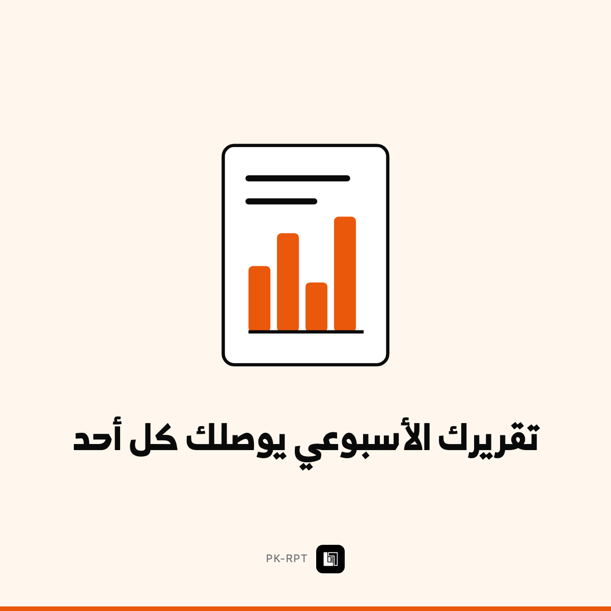

# تقريرك الأسبوعي يوصلك كل أحد

`PK-RPT` · حلول جاهزة — إدارة ومستندات · 2 خيارات

> **هذا الملف = حقول Wayl جاهزة للنسخ.** لا تعدّله — عدّل `income/wayl/items.json`
> وشغّل `node income/wayl/render.mjs`.

## 1️⃣ اسم المنتج

```
تقريرك الأسبوعي يوصلك كل أحد
```

## 2️⃣ الوصف — انسخه كاملاً

```
كل صاحب عمل يريد أرقامه، وأغلبهم ما يطلبونها — لأنهم يعرفون إن ماكو أحد راح يجهّزها.

**شنو يوصلك كل أحد:**

· **عنوان بجملة** — خلاصة الأسبوع
· فقرة تشرح شنو صار
· **جدول أرقامك مع نسبة التغيّر** عن الأسبوع الماضي
· شنو مشى زين · شنو يستاهل انتباهك
· **ثلاث خطوات محددة لهذا الأسبوع**
· أعلى الفئات وأعلى الزبائن

🔵 **الأرقام تُحسب بالكود لا بالذكاء الاصطناعي** — الذكاء الاصطناعي يكتب السرد فقط. يعني **صفر احتمال يخترع رقماً**.

**اختر درجتك:**

**أساسي** — مصدر بيانات واحد، تقرير أسبوعي بالبريد.

**+ متعدد المصادر** — حتى 3 مصادر، وإرسال على الواتساب أيضاً، وتقرير شهري مطوّل.

✅ **هذا المنتج مبني ومختبَر عندي** — أرسل لك نموذجاً حقيقياً قبل ما تدفع.
```

## 3️⃣ السعر الأساسي

**$200** · 264,000 د.ع  
*(سعر أرخص خيار — الباقي يُضاف كفروق أدناه)*

## 4️⃣ الخيارات

| الخيار | السعر | يشمل | التسليم |
|---|---|---|---|
| أساسي | $200 · 264,000 د.ع | مصدر واحد · كل أحد 7 صباحاً · أرقام محسوبة بالكود · ثلاث خطوات للأسبوع | 5 أيام |
| + متعدد المصادر | $450 · 594,000 د.ع | حتى 3 مصادر · إرسال بالواتساب · تقرير شهري مطوّل | 10 أيام |

### فروق أسعار الخيارات — أدخلها بـWayl كما هي

السعر الأساسي للمنتج: **$200** (أساسي)

| الخيار | الفرق المضاف | السعر النهائي |
|---|---|---|
| + متعدد المصادر | **+$250** | $450 · 594,000 د.ع |

## 5️⃣ الصورة



**`card.png`** بنفس المجلد · 1200×1200 · **بلا سعر وبلا درجات على الصورة** —
الأسعار بحقل الوصف حصراً.

## 6️⃣ إعدادات أخرى

| الحقل | القيمة |
|---|---|
| المخزون | **غير محدود** — خدمة لا بضاعة |
| المجموعة | حلول جاهزة — إدارة ومستندات |
| الظهور | ظاهر |
| ⚠️ بناء لمرة واحدة | **مبني أصلاً** بـ`income/products/` |

---

⬅️ [رجوع لفئة حلول جاهزة — إدارة ومستندات](../README.md) · [كل الفئات](../../README.md)
