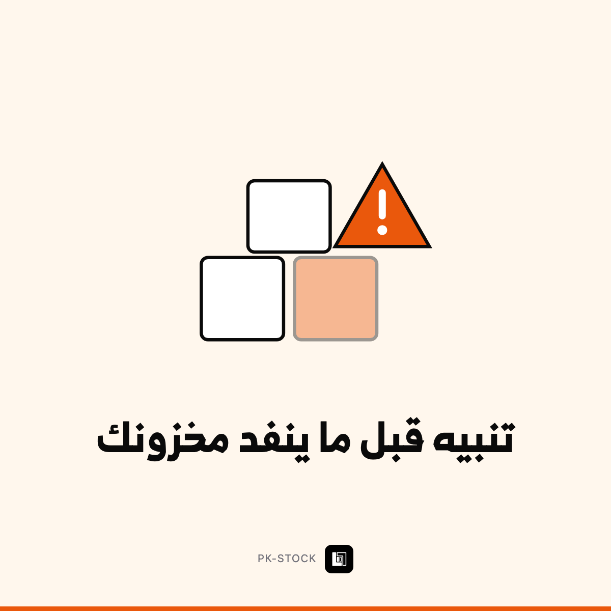

# تنبيه قبل ما ينفد مخزونك

`PK-STOCK` · حلول جاهزة — إدارة ومستندات · 2 خيارات

> **هذا الملف = حقول Wayl جاهزة للنسخ.** لا تعدّله — عدّل `income/wayl/items.json`
> وشغّل `node income/wayl/render.mjs`.

## 1️⃣ اسم المنتج

```
تنبيه قبل ما ينفد مخزونك
```

## 2️⃣ الوصف — انسخه كاملاً

```
ينفد المنتج الأكثر مبيعاً، تكتشفها لما يطلبه زبون — وتخسر البيعة والزبون سوا.

**شنو يسوي:**
يراقب كمياتك (من متجرك أو جدولك أو نظامك) و:

· **ينبّهك قبل النفاد** بحد تحدده لكل منتج
· **يحسب سرعة البيع** — منتج يبيع 10 باليوم يحتاج تنبيهاً أبكر من واحد يبيع 1
· **يجهّز طلب الشراء** جاهزاً ترسله للمورّد
· ويگلك المنتجات الراكدة اللي فلوسك واقفة بيها

**اختر درجتك:**

**تنبيه** — مراقبة وتنبيه بحد أدنى لكل منتج.

**+ ذكي** — كل ما فوق + حساب سرعة البيع، وتجهيز طلب الشراء، وتقرير الراكد.

💡 **مين يشتريها:** صيدليات · متاجر · مطاعم · مخازن قطع غيار.
```

## 3️⃣ السعر الأساسي

**$150** · 198,000 د.ع  
*(سعر أرخص خيار — الباقي يُضاف كفروق أدناه)*

## 4️⃣ الخيارات

| الخيار | السعر | يشمل | التسليم |
|---|---|---|---|
| تنبيه | $150 · 198,000 د.ع | مراقبة مستمرة · حد أدنى لكل منتج · تنبيه واتساب | 4 أيام |
| + ذكي | $320 · 422,000 د.ع | كل ما سبق · حساب سرعة البيع · طلب شراء جاهز · تقرير الراكد | 8 أيام |

### فروق أسعار الخيارات — أدخلها بـWayl كما هي

السعر الأساسي للمنتج: **$150** (تنبيه)

| الخيار | الفرق المضاف | السعر النهائي |
|---|---|---|
| + ذكي | **+$170** | $320 · 422,000 د.ع |

## 5️⃣ الصورة



**`card.png`** بنفس المجلد · 1200×1200 · **بلا سعر وبلا درجات على الصورة** —
الأسعار بحقل الوصف حصراً.

## 6️⃣ إعدادات أخرى

| الحقل | القيمة |
|---|---|
| المخزون | **غير محدود** — خدمة لا بضاعة |
| المجموعة | حلول جاهزة — إدارة ومستندات |
| الظهور | ظاهر |
| ⚠️ بناء لمرة واحدة | 12 ساعة — لا تبعه قبل ما تبنيه |

---

⬅️ [رجوع لفئة حلول جاهزة — إدارة ومستندات](../README.md) · [كل الفئات](../../README.md)
