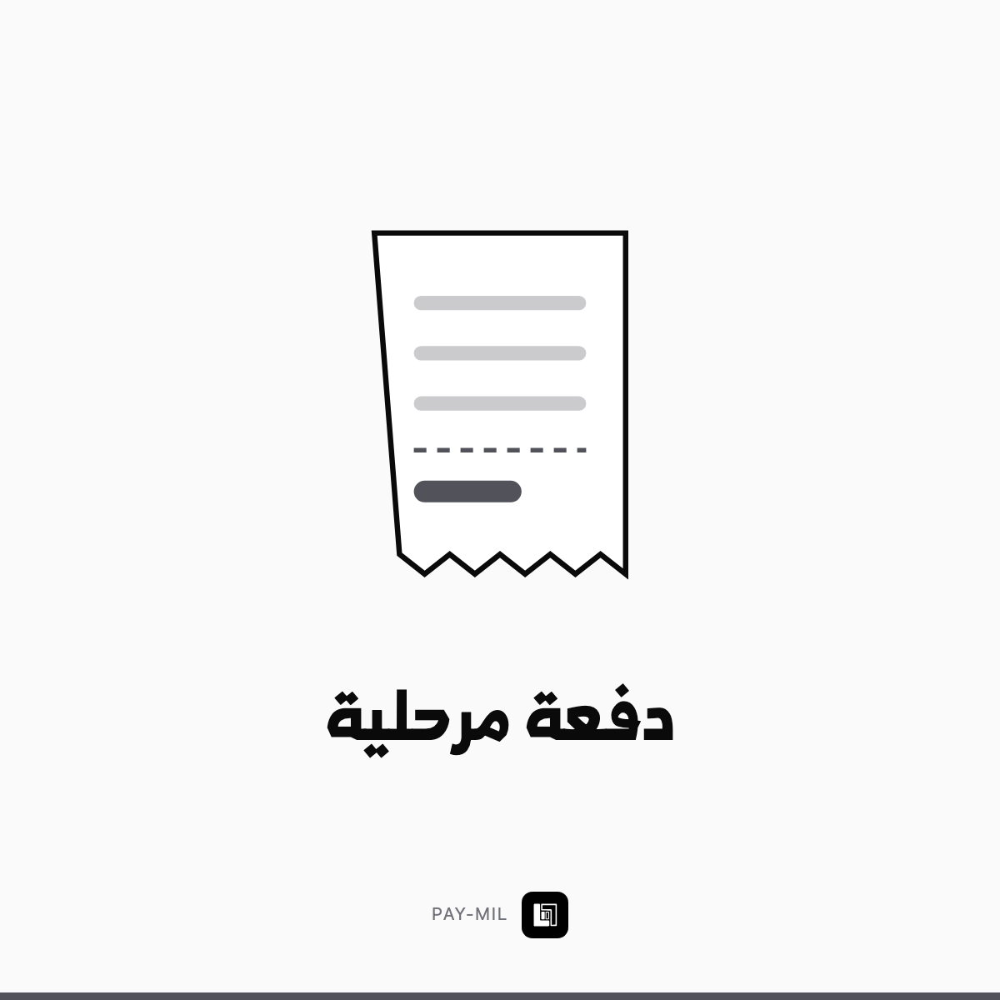

# دفعة مرحلية

`PAY-MIL` · مراحل الدفع · 1 خيار

> **هذا الملف = حقول Wayl جاهزة للنسخ.** لا تعدّله — عدّل `income/wayl/items.json`
> وشغّل `node income/wayl/render.mjs`.

## 1️⃣ اسم المنتج

```
دفعة مرحلية
```

## 2️⃣ الوصف — انسخه كاملاً

```
ليس منتجاً. دفعة عند إنجاز مرحلة متفق عليها — تُستعمل بالمشاريع الطويلة فقط.
```

## 3️⃣ السعر الأساسي

**حسب العقد** — 🔴 مبلغ مفتوح. أدخله بأقل قيمة ممكنة واذكر الآلية بالوصف.

## 4️⃣ الخيارات

بلا خيارات — منتج بسعر واحد.

## 5️⃣ الصورة



**`card.png`** بنفس المجلد · 1200×1200 · **بلا سعر وبلا درجات على الصورة** —
الأسعار بحقل الوصف حصراً.

## 6️⃣ إعدادات أخرى

| الحقل | القيمة |
|---|---|
| المخزون | **غير محدود** — خدمة لا بضاعة |
| المجموعة | مراحل الدفع |
| الظهور | 🔴 **مخفي** — يُرسل بالرابط فقط |

---

⬅️ [رجوع لفئة مراحل الدفع](../README.md) · [كل الفئات](../../README.md)
